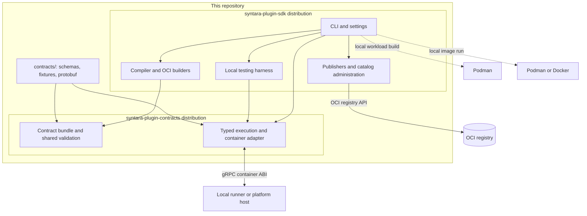
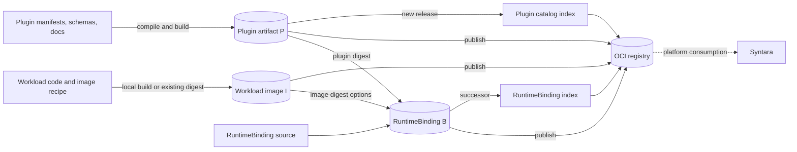
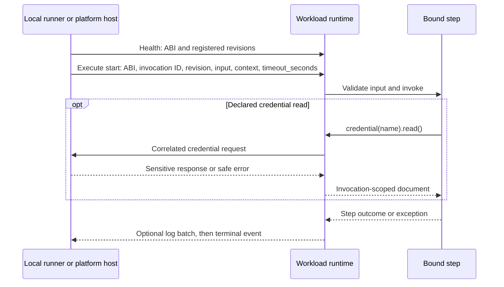

# Plugin SDK architecture overview

## Scope

This overview describes the architecture implemented by this repository and its
boundaries with Syntara, the Execution Plane, plugin authors, and OCI
registries. It introduces no new contract or deployment decision. The diagrams
are authored from the repository evidence linked below; the Execution Plane
handbook diagrams were not available for verification or reuse.

The schemas and protobuf under [`contracts/`](../../contracts/) are normative.
The SDK and supplied runtime adapter are Python. Custom-runner entry points
and the container ABI are language-neutral. Future SDK additions will provide
runtime adapters for other languages; platform behavior described here is an
integration boundary, not a claim that this repository implements it.

## System context

```mermaid
flowchart LR
    accTitle: Plugin SDK system context
    accDescr: An author publishes release objects to a registry. Syntara consumes catalog and binding objects, selects an image, and dispatches it to the Execution Plane for execution.
    author[Plugin author or CI] -->|manifests, schemas, code| sdk[Plugin SDK and CLI]
    sdk -->|release objects and indexes| registry[(OCI registry)]
    sdk -->|local validation and execution| author
    contracts[Shared contracts] --> sdk
    contracts -->|shared contracts| syntara[Syntara]
    contracts -->|shared package and ABI| ep[Execution Plane]
    registry -->|catalog and RuntimeBinding| syntara
    syntara -->|selected image digest and work| ep
    ep -->|container ABI| workload[Author-owned workload image]
    workload -->|provider operations| provider[External services]
```

A plugin declares Action, Control, and Trigger step types, integration types,
credential recipes, and documentation. A step's category describes its role;
`platform-runner` or `custom-runner` selects its implementation ownership.
An author uses the SDK to validate and compile those declarations, test custom
Python implementations, and prepare and publish release objects. The checked-in
[Go](../../examples/go-steps) and [TypeScript](../../examples/typescript-steps)
examples demonstrate language-neutral handlers and manifests; future SDK
adapters will provide their runtime support.
Syntara owns catalog consumption, installation, implementation
and image selection, workflow policy, and credential authority. The Execution
Plane hosts container execution and maps per-attempt credential callbacks to
that authority. This repository supplies the ABI and Python adapter. See the
[plugin language reference](../plugin-language.md) and
[runtime and OCI model](../runtime-and-oci.md).

## Topology and responsibilities

- [`contracts/`](../../contracts/) owns language-neutral JSON Schemas,
  conformance fixtures, and the `syntara.container/v1alpha2` protobuf. The
  Python contracts distribution packages the canonical bundle and generated
  bindings, shared validation, typed step execution, and the container runtime
  adapter. The generic workload-request hash is shared here as well.
- [`syntara-plugin-sdk`](../../sdks/python/packages/sdk/) owns compilation,
  CLI and settings, OCI artifact construction and inspection, bounded registry
  publication, catalog operations, and the optional pytest-facing testing
  harness. It depends on the contracts distribution.
- An author-owned workload image packages plugin code, manifests, and an ABI
  server. The supplied adapter loads bindings from packaged manifests
  and checks platform-supplied resolved execution data before serving exact
  registered revisions. The SDK does not provide a universal base image.
- Syntara and the Execution Plane are external to this repository. Syntara owns
  catalog trust and installation,
  approved image and implementation selection, workflow retries, and credential
  authority. The Execution Plane schedules execution attempts and maps their
  credential callbacks to the authority. A registry stores OCI objects; it does
  not confer trust merely by holding them.

See the [developer guide](../developer-guide.md),
[ADR 0001](../../.sdlc/adrs/0001-language-sdk-layout.md), and
[workload runtime bootstrap](../runtime-and-oci.md#runtime-adapters-and-workload-images).

## Release flow

Compilation validates source documents against the shared contracts and
produces a descriptor and packaged assets. Descriptor canonical digests and
revision IDs use RFC 8785 canonical JSON. A metadata-only build can create P
offline. For a custom workload, a release can also contain I and B: B binds
the exact P digest to named immutable image options. The build writes local
archives and, for the multi-object flow, a release inventory. Publication
verifies and uploads the prepared objects; a release publishes images, P when
new, B, and its index in dependency order. A new P may then update the separate
plugin catalog. An image-only update leaves P and its catalog entry unchanged.
Optional Cosign signing happens during publication when configured. Build probes
each image option's `Health` endpoint and records runtime component observations
in the RuntimeBinding. Publish re-probes and compares them with the binding.
`probeStatus` is compatibility metadata supplied by the image, not proof of
provenance or integrity; see [RuntimeBindings](../runtime-bindings.md#author-the-manifests).

Index tags are mutable pointers to immutable artifacts. Catalog generations
link to a predecessor; RuntimeBinding index updates use conditional registry
writes to detect concurrent publishers. Publication is not an atomic
transaction: receipts identify completed phases for recovery. See
[ADR 0010](../../.sdlc/adrs/0010-separate-runtime-release-lifecycle.md),
[RuntimeBindings](../runtime-bindings.md), and
[Catalog publication](../../.sdlc/adrs/0003-bounded-catalog-index-publication.md).

## Invocation flow and protocols

The protobuf defines `Health`, bidirectional `Execute`, and `Cancel` over
gRPC. The host sends input and bounded, non-secret caller-owned runtime context; the
runtime dispatches the exact advertised revision, validates input and output,
and distinguishes a completed result (including a deliberate nonzero
failure with a shared `ErrorResult`) from an invocation that produced no valid
outcome. Credentials use a separate, correlated callback by declared recipe
name. The host authorizes and
resolves the name per invocation; IDs and provider references stay on the host.
The step's invocation-scoped Toolbox can collect bounded structured logs,
which are sent at most once immediately before the terminal event. Logs are
not scrubbed on the wire. See [ADR 0011](../../.sdlc/adrs/0011-credential-callback.md),
[ADR 0013](../../.sdlc/adrs/0013-toolbox-logging.md), and the
[protobuf](../../contracts/proto/syntara_plugin/runtime/protocol/container.proto).

For local development, `syntara-plugin run` uses this ABI through a private
socket in source mode or an image runtime in image mode. The testing harness
also supports direct in-process execution. Local credentials are held in memory
and supplied by callback to a CLI-managed runtime; the CLI rejects
`--credential` for a self-managed runtime, whose host must configure its own
resolver. CI also dispatches Action, Control, Trigger, and credential-backed
test workloads through the Execution Plane Kubernetes worker, using a synthetic
credential resolver. See
[Running locally](../running-locally.md), [Testing](../testing.md), and the
[Execution Plane integration prerequisites](../developer-guide.md#prerequisites).

### Credentials, integrations, and logs

An `IntegrationType` declares the `CredentialRecipe` IDs a step may use; a
recipe defines a secret document's shape, never its value. The host authorizes
a declared recipe name and maps it to the credential authority for the attempt.
The callback is bounded and revoked with the invocation; its detailed limits
and lifecycle are defined by [ADR 0011](../../.sdlc/adrs/0011-credential-callback.md). The
Toolbox emits at most one bounded terminal `LogBatch`. Records are not scrubbed
on the wire, so plugin authors must keep secrets out of log messages and
attributes.

## Controls and trust boundaries

- The compiler and runtime validate against versioned schemas. Binding and
  bootstrap checks connect a revision, identity, entry point, ABI, and schema
  digests to packaged manifests; image selection and attestation remain platform
  responsibilities.
- OCI artifacts are content-addressed and publication verifies the prepared
  payloads. Registry credentials are invocation-scoped. HTTPS is the default;
  explicit loopback HTTP is for local development. Registry token and upload
  origins are constrained by the publication adapters. Signing is optional.
  Deployment trust policy belongs to the consumer; when extending a
  RuntimeBinding index, the publisher requires a supplied Cosign verification
  key or trusted expected predecessor digest. Consumer-side image admission,
  registry allow-lists, and signature or attestation policy remain platform
  responsibilities.
- Production container transport requires authenticated peers and
  confidentiality, using mTLS. Every TCP listener supplied by the SDK runtime,
  including a loopback listener, requires mTLS; private Unix-socket source
  runs and test-only paths are exceptions. Callback access is limited to
  declared credentials and invocation lifetime. The runtime bounds reads and
  scans outcomes for values it has delivered, but Python step code is not
  sandboxed.
- The shared workload-request digest uses RFC 8785 canonical JSON to detect
  changed request content across a trusted handoff; it is not a signature,
  credential, or authorization decision.
  See [ADR 0005](../../.sdlc/adrs/0005-generic-container-request-hash.md).

## Current limitations

- The Execution Plane compatibility test does not exercise Automation
  Orchestrator end to end or prove production deployment behavior. Its pinned
  EP revision does not supply resolved execution data, so the test generates a
  fixture from the compiled registration. A test-only bridge in the workload
  accepts plaintext on loopback and connects to the SDK runtime's mTLS
  listener. The current `v1alpha2` identifier distinguishes this protocol from
  older `v1alpha1` peers. Those legacy peers may share an identifier despite
  differing Execute protocols, so one legacy peer cannot detect that mismatch
  through `Health`.
- This repository does not establish the Syntara-to-EP transport or the Execution
  Plane's Kubernetes port-forward and certificate provisioning. A production
  integration must verify authenticated, integrity-protected Syntara-to-EP commands,
  consumer-side image-admission checks, and end-to-end mTLS to the workload
  listener.
- The custom workload build remains a developer preview. Credential
  authenticate and connection-test operations are a
  [proposal](../../.sdlc/proposals/credential-authenticate-test-v1.md), not current
  contract behavior; the TypeScript SDK is not implemented.
