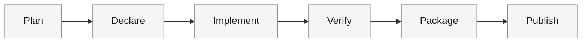
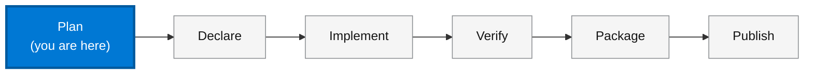
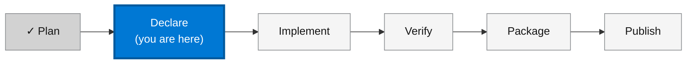
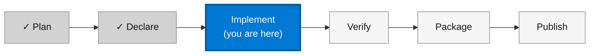
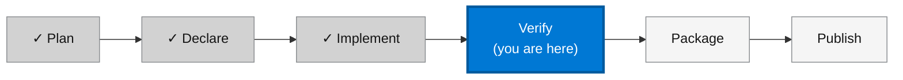
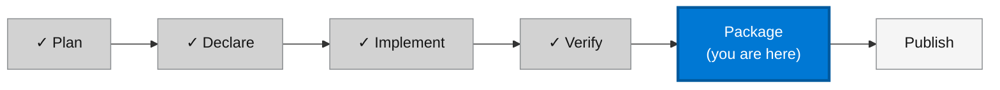
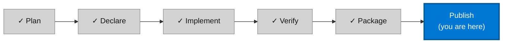
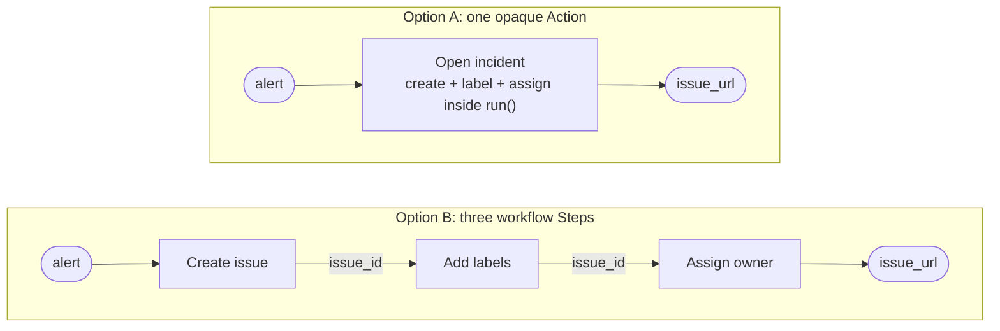
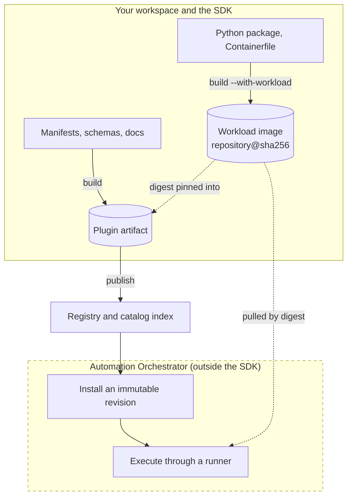

# Step authoring and composition guide

This guide takes you through the complete workflow for authoring Syntara
plugin Steps: planning a Step, declaring its contract, implementing it,
verifying it locally, packaging it, and publishing it. It also explains how to
compose Steps into readable, reliable workflows. The guide connects the
reference pages into one path; when a topic has a canonical page, the guide
covers the essentials and links to that page for the details.

The running example is an **incident intake** plugin, the kind of integration
that a platform or SRE team writes so that a repository event opens a ticket
in an issue tracker such as Jira or GitHub Issues. It follows the
[`python-steps`](../examples/python-steps) example in this repository, so you
can run the local commands in this guide against code that the SDK tests in
CI:

1. A **Record opened** Trigger receives an event from a repository.
2. A **Normalize records** Control cleans up record names.
3. A **Create issue** Action opens one issue in the tracker.

In this guide, you learn how to:

- Choose a Step category and a runner.
- Declare a Step contract in YAML and implement it in typed Python.
- Verify a Step locally, from a single run to a full test suite.
- Package and publish a plugin release.
- Decide between one Step and several Steps in a workflow.

Statements in this guide about what Syntara does describe the platform
contract that the SDK targets. The SDK does not implement the platform side.
For the boundary, see
[What Automation Orchestrator owns](#what-automation-orchestrator-owns).

## The authoring journey

Every plugin goes through the same six stages. Each stage section starts
with this diagram, with the current stage highlighted, so that you always
know where you are and what comes next:



| Stage | You decide or produce | Main command |
| --- | --- | --- |
| [Plan](#plan-your-step) | The Step category, the runner, and the Step boundaries | None |
| [Declare](#declare-the-contract) | Manifests and JSON Schemas | `syntara-plugin init` |
| [Implement](#implement-the-step) | A typed Python class (custom runner only) | None |
| [Verify](#verify-locally) | Evidence that the Step behaves as declared | `validate`, `run`, `pytest` |
| [Package](#package-the-plugin) | A deterministic OCI archive | `syntara-plugin build` |
| [Publish](#publish-the-release) | A discoverable catalog release | `syntara-plugin publish` |

After the journey, [Compose Steps into workflows](#compose-steps-into-workflows)
gives design guidance, and
[Identity and execution boundaries](#identity-and-execution-boundaries)
explains what the SDK enforces between your code and the platform.

## Prerequisites

- Python 3.12 or later, with the SDK and its testing extra installed:

  ```sh
  python -m pip install "syntara-plugin-sdk[testing]"
  ```

  For other installation options, see [Installation](installation.md).

- A clone of this repository, so that you can run the examples. Run the
  example commands from the repository root.
- For publishing only: access to an OCI registry. For a custom-runner plugin,
  you also need a container image for your code, which requires Podman or
  Docker.

If you have not created a plugin before, complete
[Getting started](getting-started.md) first.

## Key terms

| Term | Meaning |
| --- | --- |
| Plugin | A versioned release that declares Step types, integration types, credential recipes, and documentation. Its inventory is `plugin.yaml`. |
| Step type | One catalog capability, such as **Create issue**, declared by a manifest under `steps/`. |
| Category | The role of a Step type: `action`, `control`, or `trigger`. The manifest `kind` is `Action`, `Control`, or `Trigger`. |
| Runner | What executes the Step: the Syntara `platform-runner` or your own `custom-runner`. |
| Entry point | The `module:Class` handle of a custom-runner implementation, such as `python_steps.create_issue:CreateIssueStep`. |
| Workload image | The container image that holds your custom-runner code. A plugin has at most one. |
| Step identity | The stable name `namespace.plugin.step`, such as `example.python-steps.create-issue`. |

For the complete vocabulary, see
[Terms and execution model](plugin-language.md#terms-and-execution-model).

## Plan your Step

**Stage 1 of 6: Plan.** Next: [Declare](#declare-the-contract).



Before you write any YAML, decide what role the Step plays, who runs it, and
where its boundaries are. These decisions are hard to change after users
build workflows on your Step.

### Choose a category

| Category | Use it when the Step | Example |
| --- | --- | --- |
| `action` | Performs a domain operation: an API call, a script, or a data change. | Create issue, Launch job template, HTTP request |
| `control` | Shapes the flow of a workflow, or invokes another workflow. | Invoke a deploy workflow |
| `trigger` | Starts a workflow from an external event. | Record opened (webhook) |

Most Steps are Actions. Choose `control` only for orchestration behavior,
not as a general label for every capability.

> **Note:** The example implements Normalize records as a `ControlStep` so
> that the SDK tests cover the Control base class. In a production plugin, a
> pure data transformation is usually an Action.

### Choose a runner

| Question | `platform-runner` | `custom-runner` |
| --- | --- | --- |
| Can one HTTP call to a provider do the job? | Yes: declare it with the `http.v1` driver. | Use a custom runner when it cannot. |
| Do you write code? | No. The manifest is the whole Step. | Yes: a typed Python class. |
| Who owns the runtime image? | Syntara. | You do; the build pins its digest. |
| Can you run it with `syntara-plugin run`? | No. Use `validate` and `inspect`. | Yes. |

Prefer `platform-runner` whenever it is enough: you maintain no
code, and the platform supplies the endpoint and credentials after
installation. The SDK defines the operation contract for the `http.v1`
driver. Other driver names, such as `webhook.v1` in the example, pass syntax
validation, but the SDK does not define their contracts.

A platform-runner Step has no Implement stage. Go from
[Declare](#declare-the-contract) to [Validate and inspect](#validate-and-inspect),
and then to [Package](#package-the-plugin).

### Decide the Step boundaries

Decide whether a capability is one Step or several Steps now, because the
decision shapes your contracts. For guidance, see
[One opaque Step or several workflow Steps](#one-opaque-step-or-several-workflow-steps).

## Declare the contract

**Stage 2 of 6: Declare.** Next: [Implement](#implement-the-step).



The manifest is the public contract of your Step: its input schema defines
the form and the validation rules, and its output schema defines what
downstream Steps receive. Write the manifest before the code. The code must
conform to the manifest, never the reverse.

### Read the example workspace

The `python-steps` workspace has this layout:

```text
examples/python-steps/
├── plugin.yaml                          # plugin inventory
├── docs/README.md                       # documentation published with the plugin
├── steps/create-issue/manifest.yaml     # Action declaration
├── steps/record-opened/manifest.yaml    # Trigger declaration
├── python_steps/                        # Step implementations
└── tests/                               # pytest suite
```

The `plugin.yaml` file names the plugin, declares the workload image that all
custom-runner Steps share, and lists the Step manifests:

```yaml
apiVersion: syntara.io/v1alpha1
kind: Plugin
metadata:
  namespace: example
  name: python-steps
  version: 0.1.0
  displayName: Python steps
  description: One example step for each Syntara kind.
spec:
  documentation:
    path: docs/README.md
  workload:
    image: python-steps-workload
  targets:
    - steps/create-issue/manifest.yaml
    - steps/record-opened/manifest.yaml
```

The `namespace`, the plugin `name`, and each Step `name` form the Step
identity. Renaming any of them creates a different Step type, so choose
stable, lowercase names. Increase the semantic `version` for every release.

### Declare an Action

The `steps/create-issue/manifest.yaml` file declares a custom-runner Action.
The `entryPoint` names the Python class that implements it:

```yaml
apiVersion: syntara.io/v1alpha1
kind: Action
metadata:
  name: create-issue
  displayName: Create issue
  description: Creates one issue in an external tracker.
spec:
  runtime:
    kind: custom-runner
    entryPoint: python_steps.create_issue:CreateIssueStep
  input:
    kind: inline
    value:
      type: object
      properties:
        title:
          type: string
        priority:
          type: string
          default: low
          enum: [low, medium, high]
        api_token:
          type: string
          default: ""
          description: Secret token; never echoed into outputs or errors.
      required: [title]
  output:
    kind: inline
    value:
      type: object
      properties:
        issue_url:
          type: string
      required: [issue_url]
  error:
    kind: inline
    value:
      type: object
```

A platform-runner Action replaces the entry point with a driver and a bounded
operation. It never declares an origin, an authorization header, a secret, or
an image. The following excerpt is from
`examples/hello-world/steps/hello/manifest.yaml`:

```yaml
spec:
  runtime:
    kind: platform-runner
    driver: http.v1
    operation:
      method: GET
      path: /hello/{input.name}      # relative path; the platform supplies the origin
  input:
    kind: asset
    path: schemas/hello.input.yaml   # schema bundled as a separate file
```

### Declare a Trigger

A Trigger combines a platform ingress driver with the runner that implements
the Step. The `spec.configuration` schema describes driver setup, and the
`spec.input` schema describes the event that the Step receives. The following
excerpt is from `examples/python-steps/steps/record-opened/manifest.yaml`:

```yaml
spec:
  driver: webhook.v1
  runtime:
    kind: custom-runner
    entryPoint: python_steps.record_opened:RecordOpenedStep
  configuration:          # driver setup; not invocation input
    kind: inline
    value:
      type: object
  input:                  # the event payload
    kind: inline
    value:
      type: object
      properties:
        repository:
          type: string
      required: [repository]
```

### Declare a Control

A Control adds `spec.invocation`. Use `kind: orchestration` for control-flow
behavior, or `kind: workflow-invocation` with a `workflow` identity to invoke
a named workflow. The example workspace does not ship a Control manifest. The
following manifest validates and runs against the example's
`NormalizeRecordsStep` when you add it to the workspace as
`steps/normalize-records/manifest.yaml` and list it in `spec.targets`:

```yaml
apiVersion: syntara.io/v1alpha1
kind: Control
metadata:
  name: normalize-records
  displayName: Normalize records
  description: Lowercases and trims record names.
spec:
  invocation:
    kind: orchestration
  runtime:
    kind: custom-runner
    entryPoint: python_steps.normalize_records:NormalizeRecordsStep
  input:
    kind: inline
    value:
      type: object
      description: Record names to normalize.
      properties:
        records:
          type: array
          description: Raw record names.
          items:
            type: string
      required: [records]
  output:
    kind: inline
    value:
      type: object
      description: Normalized record names.
      properties:
        normalized:
          type: array
          description: Lowercased, trimmed record names.
          items:
            type: string
        count:
          type: integer
          description: Number of normalized records.
      required: [normalized, count]
```

For a `workflow-invocation` example, see
[`contracts/fixtures/control.valid.json`](../contracts/fixtures/control.valid.json).

### Write schemas that explain themselves

Every `input`, `output`, and optional `error` source is a JSON Schema 2020-12
document, either `inline` in the manifest or an `asset` file. Follow these
practices:

- Add a `description` to the root object and to every user-facing property.
  Descriptions become form help and output documentation.
- Use `asset` for schemas that are long or shared between Steps.
- Constrain inputs with `required`, `enum`, `minLength`, and
  `additionalProperties: false`, so that invalid input fails before your code
  runs.
- Declare the output precisely. The output schema is all that downstream
  Steps can rely on.
- Mark secret input fields with `writeOnly: true` or `format: password`.

> **Important:** Marking a field as secret controls local redaction in
> `syntara-plugin run`, which also masks fields with credential-like names
> such as `api_token`. It is not a credential delivery mechanism. Production
> credentials belong in an
> [`IntegrationType`](plugin-language.md#kind-integrationtype) and its
> [`CredentialRecipe`](plugin-language.md#kind-credentialrecipe). Credential
> delivery to custom runners is not available in this SDK revision, so do
> not copy the example's `api_token` input for real credentials.

For every manifest field, see the
[Plugin language reference](plugin-language.md).

### Start your own plugin

To start a plugin of your own, scaffold a workspace:

```sh
syntara-plugin init ./incident-tracker --namespace acme --fields title
```

The command creates `plugin.yaml`, `syntara-plugin.yaml`, `docs/README.md`,
`steps/request/manifest.yaml`, and `schemas/request.input.yaml`. The
generated Step is a platform-runner `http.v1` Action whose input schema has
a required `resource` field plus the optional `title` field that `--fields`
adds. For every `init`
option, see [Getting started](getting-started.md#create-your-first-plugin).

For a Python custom-runner Action, choose the runner when scaffolding:

```sh
syntara-plugin init ./incident-tracker --namespace acme \
  --runner custom-runner --fields title
```

This adds the workload declaration and build settings, a typed Python Action,
runtime configuration, a Containerfile, and local tests. Its temporary
single-Action binding adapter reads the packaged manifests; AAP-97120 will
provide a public helper to replace it. See [Getting started](getting-started.md#create-a-python-custom-runner)
for running the scaffold and preparing its image. Review generated models and
schemas together, particularly when using complex JSON Schema constructs.

## Implement the Step

**Stage 3 of 6: Implement** (custom runner only). Next: [Verify](#verify-locally).



A custom-runner Step is a Python class that subclasses `ActionStep`,
`ControlStep`, or `TriggerStep` from `syntara_plugin.runtime`. All three
share one lifecycle: the SDK validates the raw input against the manifest
schema, builds your Pydantic input model, calls your `run()` method once, and
validates the returned object against the manifest output schema.

### Model the contract and write `run()`

The `examples/python-steps/python_steps/create_issue.py` file implements the
Create issue Action:

```python
from typing import Literal

from pydantic import BaseModel
from syntara_plugin.runtime import ActionStep, ExecutionContext


class CreateIssueInput(BaseModel):
    """The declared input contract; mirrors steps/create-issue/manifest.yaml."""

    title: str
    priority: Literal["low", "medium", "high"] = "low"
    api_token: str = ""


class CreateIssueOutput(BaseModel):
    """The declared output contract; never echoes the API token."""

    issue_url: str


class CreateIssueStep(ActionStep[CreateIssueInput, CreateIssueOutput]):
    """Create one issue; the api_token is accepted but never echoed."""

    def run(self, inputs: CreateIssueInput, context: ExecutionContext) -> CreateIssueOutput:
        slug = inputs.title.lower().replace(" ", "-")
        return CreateIssueOutput(issue_url=f"https://issues.example.test/{slug}")
```

A Control follows the same pattern. The
`examples/python-steps/python_steps/normalize_records.py` file implements
Normalize records:

```python
from pydantic import BaseModel
from syntara_plugin.runtime import ControlStep, ExecutionContext


class NormalizeRecordsInput(BaseModel):
    records: list[str]


class NormalizeRecordsOutput(BaseModel):
    normalized: list[str]
    count: int


class NormalizeRecordsStep(ControlStep[NormalizeRecordsInput, NormalizeRecordsOutput]):
    """Lowercase and trim every record name."""

    def run(
        self, inputs: NormalizeRecordsInput, context: ExecutionContext
    ) -> NormalizeRecordsOutput:
        normalized = [record.strip().lower() for record in inputs.records]
        return NormalizeRecordsOutput(normalized=normalized, count=len(normalized))
```

For the Trigger, see
[`record_opened.py`](../examples/python-steps/python_steps/record_opened.py).
Follow these rules in every implementation:

- **Mirror the manifest.** The Pydantic models must accept every value that
  the input schema allows and emit only values that the output schema allows.
  [Run one Step](#run-one-step) checks this.
- **Override `run()`, not `execute()`.** The SDK calls `execute()`, which
  calls `run()`.
- **Return the output model.** Do not return a dictionary or a wrapper; the
  SDK builds the result envelope.
- **Keep the entry point importable from the workspace root.**
  `python_steps.create_issue:CreateIssueStep` resolves to
  `python_steps/create_issue.py`.

### Use the execution context

The `context` argument is an `ExecutionContext`. It carries the
`invocation_id`, an optional `workflow_run_id`, bounded non-secret
`runtime_context` data, and a `cancelled` flag for cooperative cancellation.
It exposes no credentials and no transport types. Check `context.cancelled`
before a long or irreversible operation, and stop with a `CANCELLED` failure
when it is `True`.

### Signal a deliberate failure

When a Step cannot complete for a reason that the workflow user needs to
know, raise `ContainerInvocationError` with a `FailureCode`:

```python
from syntara_plugin.runtime import ContainerInvocationError, FailureCode


class CreateIssueStep(ActionStep[CreateIssueInput, CreateIssueOutput]):
    def run(self, inputs, context):
        response = tracker.create(inputs.title)  # your provider client
        if response.status == 429:
            raise ContainerInvocationError(
                FailureCode.RATE_LIMITED,
                "The tracker rate limit was reached.",
                retryable=True,
            )
        # Build and return CreateIssueOutput from the response.
```

| Situation | Code | `retryable` |
| --- | --- | --- |
| The provider throttled the request | `RATE_LIMITED` | `True` |
| A temporary provider outage | `UPSTREAM_TRANSIENT` | `True` |
| The provider rejected the request | `REMOTE_REJECTED` | Depends on the reason |
| The target does not exist | `NOT_FOUND` | `False` |
| Cancellation was requested | `CANCELLED` | `False` |

The optional `outcome` argument states how far the operation got:
`not_started`, `not_completed` (the default), or `unknown`. Write the message
for the workflow user: short, actionable, and free of secrets. The failure
code, message, retryability, and outcome are handed to the platform, which
owns retry policy. For every code, see `FailureCode` in
[`abi.py`](../sdks/python/packages/contracts/src/syntara_plugin/runtime/abi.py).

> **Note:** `syntara_plugin.runtime` exports `ContainerInvocationError`
> lazily from the container transport, so importing it loads the gRPC
> dependencies.

For the typed API in depth, see
[Typed Python steps](runtime-and-oci.md#typed-python-steps).

## Verify locally

**Stage 4 of 6: Verify.** Next: [Package](#package-the-plugin).



Verify from the fastest check to the most thorough one. Each tool proves
something that the previous one cannot:

| Tool | Proves | Does not prove |
| --- | --- | --- |
| `syntara-plugin validate` | Manifests match the contracts and each other. | Anything about Python code. |
| `syntara-plugin inspect` | The compiled descriptor is what you expect. | Anything about Python code. |
| `syntara-plugin run` | One invocation works over the container ABI, and the models match the manifest. | Edge cases and regressions. |
| `pytest` with the testing harness | Valid input reaches `run()` once, invalid input never does, both execution paths agree, and secrets do not leak. | End-to-end platform execution. |

> **Important:** `validate` and `build` never import your Python code. A
> misspelled entry point or a model that drifts from the manifest passes both.
> For custom-runner Steps, run `syntara-plugin run` or `pytest` before you
> package.

### Validate and inspect

To check the manifests, validate the workspace:

```sh
syntara-plugin validate examples/python-steps/plugin.yaml
```

The command prints `Valid:` followed by the manifest path and the descriptor
digest. To review the compiled descriptor, inspect the workspace. Like
`build`, `inspect` requires an immutable image binding for each custom-runner
workload image:

```sh
syntara-plugin inspect examples/python-steps/plugin.yaml \
  --image-binding python-steps-workload=<repository>@sha256:<digest>
```

A platform-runner plugin needs no binding:

```sh
syntara-plugin inspect examples/hello-world/plugin.yaml
```

The command prints the compiled `PluginDescriptor` as JSON. Check the
`identity`, `runtime`, and resolved schemas of each target.

### Run one Step

The `run` command executes one custom-runner Step from your source, through
the same container ABI that the platform uses. To run a Step, follow these
steps:

1. Print an input template:

   ```sh
   syntara-plugin run --manifest examples/python-steps/plugin.yaml create-issue
   ```

   The command executes nothing. It prints a schema-shaped template on
   standard output, a field summary on standard error, and exits with status
   `2`. The template is not business-valid; fill in real values.

2. Run the Step with real input:

   ```sh
   syntara-plugin run --manifest examples/python-steps/plugin.yaml create-issue \
     --input '{"title": "Checkout service build failed", "priority": "high"}'
   ```

   The output is similar to the following:

   ```text
   Target:         example.python-steps.create-issue
   Mode:           source
   Input:          {"title": "Checkout service build failed", "priority": "high"}
   Invocation:     run-<generated_id>
   Status:         0
   Status message: Completed

   Output:
   {
     "issue_url": "https://issues.example.test/checkout-service-build-failed"
   }
   ```

3. Confirm that invalid input never reaches your code:

   ```sh
   syntara-plugin run --manifest examples/python-steps/plugin.yaml create-issue \
     --input '{"priority": "urgent"}'
   ```

   The command reports every violation and exits with status `2`:

   ```text
   error: input does not satisfy the declared schema for example.python-steps.create-issue
     inputs/title: required property is missing
     inputs/priority: enum constraint is not satisfied

   Nothing was executed. Next:
     fix --input and rerun
     or run without --input/--input-file to print a template
   ```

For secret values, use `--input-file` instead of `--input`, so that secrets
stay out of your shell history. For image mode, exit codes, and
troubleshooting, see [Run a Step locally](running-locally.md).

### Generate a test suite

The `test-init` command generates one test module per custom-runner target.
To generate and complete a suite, follow these steps:

1. Copy the example workspace, so that the example in the repository stays
   unchanged:

   ```sh
   cp -R examples/python-steps ~/python-steps
   ```

2. Generate the tests into a directory inside the copied workspace. The
   example already has a `tests/` directory, so use a new one:

   ```sh
   syntara-plugin test-init ~/python-steps --tests-dir ~/python-steps/generated-tests
   ```

   In your own plugin, omit `--tests-dir` to write the tests to the
   workspace `tests/` directory. Keep the tests directory inside the
   workspace, because the generated tests locate the workspace relative to
   their own location.

3. Run the suite:

   ```sh
   pytest ~/python-steps/generated-tests -q
   ```

   For each target, the invalid-input test passes and two tests are skipped
   until you complete them. With two targets, the result is
   `2 passed, 4 skipped`.

4. In each generated module, replace the placeholder in `VALID_CASES` with a
   business-valid payload, and then remove the `@pytest.mark.skip` markers.
   For example, in `test_create_issue.py`:

   ```python
   VALID_CASES = [
       {"title": "Checkout service build failed", "priority": "high"},
   ]
   ```

The tests use the harness fixtures, which pytest loads automatically when the
`testing` extra is installed.

### Prove both execution paths agree

The harness runs a Step two ways: directly in Python with `invoke_step`, and
over a loopback gRPC server with `invoke_step_in_container`. The
`check_step_conformance` helper checks the core guarantees in one call. The
following test is from
`examples/python-steps/tests/test_create_issue_action.py`:

```python
def test_conformance_in_one_call(mock_execution_context, step_bindings) -> None:
    from syntara_plugin.testing import check_step_conformance

    binding = step_bindings.bind_step(CreateIssueStep, workspace=WORKSPACE)
    report = check_step_conformance(
        binding,
        valid_cases=[{"title": "Broken build"}],
        invalid_cases=[{}, {"title": "x", "priority": "urgent"}],
        context=mock_execution_context(),
    )
    assert report.passed, report.failures
```

Use `step_bindings.bind_step` for a Step that has a manifest: it compiles the
workspace, installs the manifest, and checks the Pydantic models against the
schemas. Use `step_bindings.bind` for a class without a manifest; it installs
a manifest derived from the models.

The harness does not redact anything. To prove that a Step never leaks a
secret, pass a `secret_sentinel()` value as input and call
`assert_no_secrets` on the outcome.

### Use the reference fixtures

- [`contracts/fixtures`](../contracts/fixtures) holds example documents for
  the manifest contracts, such as `trigger.valid.json` and
  `trigger.invalid.json`.
- `syntara_plugin.testing.payloads` provides standard payload cases and the
  `ReferenceControlStep` and `FailingReferenceStep` stand-ins.
- The example suite runs from the repository root:

  ```sh
  uv run --no-sync pytest examples/python-steps/tests -q
  ```

For every fixture and helper, see the [Testing reference](testing.md).

## Package the plugin

**Stage 5 of 6: Package.** Next: [Publish](#publish-the-release).



The `build` command compiles the workspace into a deterministic OCI archive:
the same source always produces the same digests. The build is offline. It
does not contact a registry, build an image, or run anything.

### Build a platform-runner plugin

From a workspace created with `init`, build the archive:

```sh
syntara-plugin build
```

To verify the archive and list its contents, inspect it:

```sh
syntara-plugin inspect ./dist/incident-tracker.oci.tar
```

### Build a custom-runner plugin

A custom-runner plugin must pin its workload image to an immutable digest.
Without a digest, the build fails:

```text
error: IMAGE_BINDING_MISSING: No explicit immutable binding was supplied for 'incident-tracker-workload'.
```

If you already have an image digest, pass it with `--image-binding`, or set
it once under `build.imageBindings` in `syntara-plugin.yaml`:

```sh
syntara-plugin build \
  --image-binding incident-tracker-workload=<repository>@sha256:<digest>
```

To have the SDK build and push the image instead, use the
`build --with-workload` flow. It requires a `Containerfile` and a bindings
factory that you write. For the procedure, see
[Optional custom-runner image build](user-guide.md#optional-custom-runner-image-build),
and for the image pattern, see [Image mode](running-locally.md#image-mode).

## Publish the release

**Stage 6 of 6: Publish.** Next: [Compose Steps into workflows](#compose-steps-into-workflows).



Publish the exact archive that you verified. The `publish` command does not
recompile. It uploads the archive and advances the configured catalog index,
so that the platform can discover the release.

1. In `syntara-plugin.yaml`, configure the non-secret registry, publish, and
   catalog settings:

   ```yaml
   registry:
     origin: https://registry.example.test
     artifactRepository: acme/plugins/incident-tracker
     catalogRepository: acme/catalog-index
     username: publisher
   publish:
     channel: 0.1.0
   catalog:
     sourceId: production-catalog
     channel: stable
     expiresInHours: 168
   ```

   The command checks the catalog settings only after it uploads the
   artifact, so configure all of them before you publish. Never store a
   password or token in this file.

2. Publish the archive, passing the password on standard input:

   ```sh
   printf '%s' "$REGISTRY_PASSWORD" | syntara-plugin publish \
     ./dist/incident-tracker.oci.tar --password-stdin
   ```

To stage a release without making it discoverable, set
`publish.updateCatalog: false`. For catalog settings, administration, and
recovery, see the [User guide](user-guide.md) and the
[Build settings reference](build-settings.md).

## Compose Steps into workflows

The hardest authoring decisions are about boundaries: what goes inside one
Step, and what belongs in the workflow between Steps.

### One opaque Step or several workflow Steps

Suppose that, when an alert fires, the team wants to create an issue, label
it, and assign it to the on-call engineer. You can build an opaque **Open
incident** Action that does all three inside `run()`, or three Actions that
the workflow connects:



Use this table to choose:

| Prefer one opaque Step when | Prefer several Steps when |
| --- | --- |
| The operations always run together and fail together. | Someone needs to see, approve, or branch on an intermediate result. |
| Intermediate data is an implementation detail or is sensitive. | A part is reusable on its own, such as Add labels. |
| Retrying the whole operation is safe. | Parts have different retry or idempotency behavior. |
| Splitting creates Steps that nobody uses alone. | Parts need different runners, integrations, or permissions. |

In this example, retry behavior decides. If labeling fails in Option A, a
retry runs `run()` again and creates a second issue. In Option B, the
platform can retry Add labels without touching Create issue. As a rule of
thumb, if a workflow author would ever ask "which part failed?", the parts
are separate Steps.

The example workspace contains a runnable pair that shows both shapes:
[`ComposeRemediationStep`](../examples/python-steps/python_steps/compose_remediation.py)
normalizes and plans inside one `run()`, while
[`NormalizeRecordsStep`](../examples/python-steps/python_steps/normalize_records.py)
is a reusable Step that a chain connects to the next one. Both use
`ControlStep` for test coverage; the composition principles are the same for
Actions.

### Keep boundaries observable

A Step is observable only through its declared output and its terminal
status. The typed SDK gives `run()` no progress API, so nothing that happens
inside `run()` is visible to the workflow. Design the output for the next
Step:

- Return the identifiers and URLs that downstream Steps need, such as
  `issue_url`.
- Keep output field names and types stable. A change breaks every workflow
  that reads them, so treat it as a breaking change and release it as a new
  plugin version.
- Do not return secrets, raw provider responses, or debugging data.

### Handle errors at the right boundary

- Fail deliberately with `ContainerInvocationError` and a precise
  `FailureCode`, as described in
  [Signal a deliberate failure](#signal-a-deliberate-failure).
- Set `retryable=True` only when retrying the whole Step is safe.
- Design for retries. Create issue is a classic non-idempotent call: a retry
  after a timeout can open a duplicate issue. When the provider supports
  idempotency keys, derive the key from input values that stay the same
  across retries. When you cannot tell whether the operation happened, use
  `outcome="unknown"` and `retryable=False`.
- Split Steps at retry boundaries, as in Option B.

A manifest `error` schema is optional. It documents a domain error shape and
does not replace the SDK-owned failure envelope.

### Keep the workflow readable

A workflow is a directed acyclic graph (DAG) that people read, review, and
debug. To keep it readable, follow these practices:

- Name Steps by outcome, such as **Create issue**, not by mechanism, such as
  **POST to API**.
- Give each Step one responsibility that fits in its `description`.
- Fold glue logic into the Step that owns the data instead of adding chains
  of trivial transformation Steps.
- Put branching and fan-out in Control Steps, so that the graph shows them.
- Keep the internal operations of an opaque Step private. Do not expose their
  names as Step identities or as output fields that workflows depend on, and
  report a `FailureCode` instead of the name of the internal operation that
  failed. If workflow authors need to address a part directly, promote it to
  its own Step type with its own manifest.

### Test a composition locally

The `chain_steps` helper runs Steps in sequence with explicit seams between
them, and `check_seam_compatible` checks whether one Step's output fits the
next Step's input. The following excerpt is from
`examples/python-steps/tests/test_normalize_records_step.py`:

```python
first = step_bindings.bind(NormalizeRecordsStep, identity="example.python-steps.normalize-1")
second = step_bindings.bind(NormalizeRecordsStep, identity="example.python-steps.normalize-2")

# The output field "normalized" is not the input field "records", so a seam is required.
seam_report = check_seam_compatible(first, second)
assert not seam_report.passed(), "normalize output is not directly normalize input"

outcome = chain_steps(
    [first, second],
    {"records": ["Alpha"]},
    context=mock_execution_context(workflow_run_id="example-chain"),
    seams=[lambda output: {"records": output["normalized"]}],
)
assert outcome.ok
```

The `chain_steps` helper is not a workflow engine: it has no branching,
parallelism, retries, or persistence. When you need control flow, implement
it in a `ControlStep.run()` method and test that Step. For more information,
see [Chaining steps](testing.md#chaining-steps).

## Identity and execution boundaries

This section explains the boundaries that the SDK enforces between your code
and the platform. You do not need it for a first plugin, but it explains why
the SDK works the way it does. The following diagram shows how a release
moves from your workspace to execution:



### Installed revision identity

When a plugin is installed, each Step becomes an immutable installed
revision. Its identity comes from the compiled descriptor
(`namespace.plugin.step`), never from a source file name. Do not hard-code
build-generated revision IDs. For more information, see
[Installed revision mapping](runtime-and-oci.md#installed-revision-mapping).

### Entry point and artifact binding

The `entryPoint` value names your implementation inside the workload image.
The build binds the plugin's logical image ID to an immutable
`repository@sha256:<digest>` reference, never a mutable tag. Inside the
image, a bindings factory registers each Step through its installed manifest,
so that the manifest schema stays the execution contract. The SDK publishes
no universal base image; each language adapter provides its own image recipe
on top of the shared container ABI. The Python adapter is
`syntara_plugin.runtime` in the `syntara-plugin-contracts` distribution. For
more information, see
[Runtime adapters and workload images](runtime-and-oci.md#runtime-adapters-and-workload-images).

### Execution placement

The entry point is an implementation identity, not a placement decision:
platform policy can run the Step in the selected host execution path or
delegate it to the Execution Plane. The category does not choose placement
either. Do not write code that depends on the host, network location, or
process that runs it.

### Direct execution and the container path

The SDK runs a Step through two paths with the same input validation and the
same single call to `run()`:

- **Direct execution** (`StepExecutor`, `invoke_step`) runs the typed
  implementation in-process, without gRPC. See
  [Minimal direct execution](runtime-and-oci.md#minimal-direct-execution).
- **The container path** (`syntara-plugin run`, `invoke_step_in_container`,
  and the workload image) runs the same implementation behind the
  `syntara.container/v1alpha1` gRPC protocol.

The two paths report outcomes differently:

| Outcome | Direct path | Container path |
| --- | --- | --- |
| Success | `StandardOutputWrapper` with `status` `0`, `status_message` `Completed`, and `output` | Terminal result with the same fields |
| Invalid input; `run()` is not called | Wrapper with a nonzero `status` and an `error` of code `INVALID_INPUT` | Terminal result with a nonzero status and the same error |
| Deliberate failure (`ContainerInvocationError`) | The exception is raised | Terminal failure with the code, message, retryability, and outcome |
| Unexpected exception | The exception is raised, with its original text | Terminal failure `OUTCOME_UNKNOWN`; the exception text does not leave the container |
| Output that violates the output schema | `StepExecutionError` is raised | Terminal failure `ABI_VIOLATION` |

In tests, a deliberate failure leaves `outcome.error` empty on both paths
and stores the exception in `outcome.raised`, so assert
`outcome.raised.code`. Assert through `StepOutcome` accessors rather than raw
fields, because the container mapping is provisional and the canonical
wrapper is tracked separately. For more information, see
[Container adapter](runtime-and-oci.md#container-adapter).

### What Automation Orchestrator owns

> **Important:** The following responsibilities belong to Automation
> Orchestrator and the Execution Plane, outside the SDK. This SDK revision
> does not implement them, and passing local tests does not prove them:
>
> - Mapping an installed revision to its implementation and image digest in
>   the platform registry.
> - Running custom-runner workload images in the Execution Plane.
> - Delivering credentials to custom runners as short-lived, read-only files.
> - Placement, retry, and cancellation policy for workflow invocations.

## Next steps

| Goal | Document |
| --- | --- |
| Look up every manifest field | [Plugin language reference](plugin-language.md) |
| Run a Step in image mode or troubleshoot `run` | [Run a Step locally](running-locally.md) |
| Use every fixture and testing helper | [Testing reference](testing.md) |
| Configure `syntara-plugin.yaml` | [Build settings reference](build-settings.md) |
| Publish, stage, or recover a catalog release | [User guide](user-guide.md) |
| Understand the container ABI and image binding | [Runtime and OCI model](runtime-and-oci.md) |
